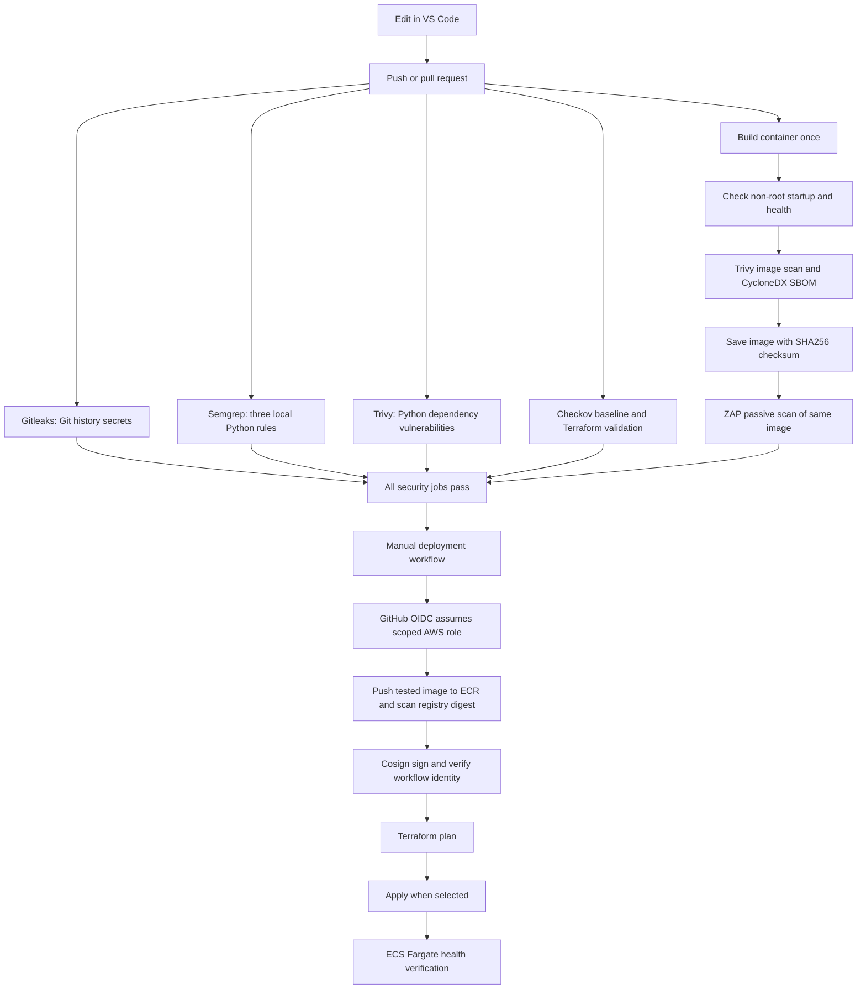

# DevSecOps self-build lab

A personal Flask demo for learning security gates, container delivery and AWS OIDC.
All code is synthetic. Do not add employer code, credentials or customer data.

## How it works



## Run security checks without Docker on your laptop

1. Edit files in VS Code and push a commit to `main`, or open a pull request.
2. Open this repository's **Actions → Security checks**.
3. Open a run and expand individual steps to see commands and results.
4. To repeat manually, choose **Run workflow → main → Run workflow**.
5. The run's **Artifacts** include the tested image, image scan JSON,
   CycloneDX SBOM and ZAP report. Artifacts expire after three days.

GitHub-hosted Ubuntu runners build and run the container. Local Docker or Podman
is optional. The work laptop currently encounters a corporate certificate trust
failure on registry downloads; this pipeline does not change laptop trust settings.

## Understand the security gates

| Gate | What blocks the pipeline | Scope |
| --- | --- | --- |
| Gitleaks | Detected secrets | Entire checked-out Git history, redacted output |
| Semgrep | Any local rule finding | eval, subprocess shell=True, Flask debug=True |
| Trivy dependency scan | HIGH/CRITICAL findings | requirements.txt |
| Trivy image scan | HIGH/CRITICAL findings | OS and packaged dependencies in built image |
| Checkov | Failed selected checks | SG descriptions/open SSH/RDP, separate ECS roles, current Fargate platform, nonprivileged containers, no host PID, read-only root |
| Terraform | Formatting, initialization or validation errors | terraform/ |
| Runtime smoke check | Failed startup, non-root configuration or health endpoint | Built container |
| ZAP baseline | Configured FAIL alerts or scan errors | Passive checks against isolated demo container |

This is a teaching baseline, not a full security audit or CIS/NIST certification.
Semgrep has three deliberately small local rules. ZAP is passive, not a full active
penetration test. Missing CSP, anti-framing and content-type protection are FAIL
alerts; other ZAP warnings remain visible in reports but do not block (`-I`).
An SBOM inventories packages; it does not itself assert that an image is safe.

## AWS bootstrap: one-time prerequisite

The old S3 interview lab role trusts another repository and cannot deploy this app.
Create a separate CloudFormation stack in the intended sandbox account and Sydney
(`ap-southeast-2`) using `bootstrap/cloudformation.yml`.

- Stack name: `devsecops-selfbuild-bootstrap`.
- Leave the GitHub owner/repository and immutable ID parameters at their defaults.
- Leave `CreateGitHubProvider=false` when the account already contains
  `token.actions.githubusercontent.com` (the earlier lab created it).
- Review IAM permissions, acknowledge IAM resource creation, then create the stack.
- The ECR repository name `devsecops-selfbuild` must be available in that region.

The stack creates an encrypted/versioned private state bucket, immutable-tag ECR
repository, separate ECS execution/task roles, and a scoped GitHub deployment role.
Its OIDC trust allows only this repository's main branch, using immutable owner and
repository IDs. GitHub requests a short-lived OIDC token; AWS STS checks its claims
and issues temporary credentials. No stored AWS access keys are required.

Configure these repository **Settings → Secrets and variables → Actions → Variables**
from stack outputs:

| Variable | Value |
| --- | --- |
| AWS_ACCOUNT_ID | AWSAccountID output |
| AWS_REGION | AWSRegion output |
| AWS_ROLE_ARN | AWSRoleARN output |
| TF_STATE_BUCKET | TFStateBucket output |
| EXECUTION_ROLE_ARN | ExecutionRoleARN output |
| TASK_ROLE_ARN | TaskRoleARN output |

Add **ALLOWED_CIDR** as a repository **secret**, containing your trusted public IPv4
address followed by `/32`. Do not commit it or a tfvars file. Recheck your public IP
when changing networks. Secrets are unavailable to pull requests from forks.

## Plan and deploy

1. Actions → **Deploy signed ECS application → Run workflow**.
2. Select `plan` first. All security checks run, then the tested image is published
   to ECR, the registry digest is scanned, signed and verified, and Terraform prints
   the infrastructure plan. **Plan publishes/signs an image; it is not entirely
   read-only.** It does not apply Terraform application infrastructure.
3. Review the plan. Run the workflow again with `apply` to deploy.
4. It applies the saved plan within that run and verifies ECS container health and
   the requested image reference. Find the demo URL in the job summary.
5. Open that URL from the network allowed by ALLOWED_CIDR. GitHub runners are outside
   your allowlist, so ZAP runs against an isolated CI container instead of AWS.

Terraform provisions a dedicated VPC, one subnet, internet gateway/routes, restricted
security group, log group, ECS cluster, task definition and one Fargate task.
It reads the bootstrap-owned ECR repository. It does not own the bootstrap IAM roles,
state bucket or registry. AWS state uses S3 encryption, versioning and native S3
lockfiles. Commit `.terraform.lock.hcl`; never commit `.terraform/` or state.

This demo uses **HTTP on port 8080 restricted to one public IPv4 address**. It has no
TLS, authentication, domain, load balancer or NAT gateway. Use synthetic data only.
The task has a public IP for outbound registry/log access. Its endpoint changes when
the task is replaced. Production needs a separate design for TLS, availability,
authentication, network boundaries and approvals. Fargate, public IPv4, ECR, logs and
storage can incur charges while the lab exists.

An immutable Git commit image tag is reused on reruns and rescanned by digest.
Because package indexes change, rebuilding the same source is not guaranteed to
produce the same image. The first published image for that commit is retained.
Cosign verifies the GitHub deployment workflow identity before Terraform deploys
the image digest; ECS does not independently enforce signature verification.

## Local development without containers

From the project root, with Python installed:

```powershell
python -m venv .venv
.\.venv\Scripts\python.exe -m pip install -r requirements.txt
.\.venv\Scripts\python.exe -m flask --app app.main run --host 127.0.0.1 --port 8080
```

Open http://127.0.0.1:8080/ and /health. This is Flask's local development server;
the container uses Gunicorn. Dependency downloads still need trusted HTTPS access.

If local certificate setup is approved and fixed, use `scripts/start-local.ps1` to
build/run with native Docker or the Podman compatibility wrapper in Oracle Linux WSL.

## Rollback and cleanup

ECS deployment circuit breaker can roll back a failed update when a previous
successful deployment exists. It cannot recover an initial deployment to a version
that never existed. `scripts/rollback.sh` can restore a known previous task definition
from an authenticated administrative shell; set PROJECT_NAME, AWS_REGION and
ROLLBACK_TASK_DEFINITION first. Reconcile the Terraform desired image afterward.

To stop application charges, run the deploy workflow with **destroy**. This removes
Terraform-owned application resources; it retains the bootstrap registry, IAM roles
and state bucket. The workflow still requires its security checks to pass.
For complete cleanup, inspect remaining ECR images/S3 object versions, then remove
them deliberately and delete the bootstrap stack. State bucket and registry have
retention policies; deleting the stack alone does not remove them. Do not delete
the shared GitHub OIDC provider while the old lab still uses it.

GuardDuty and Security Hub are separate account-level services; this project does
not enable them or claim their findings are part of these pipeline scans.
